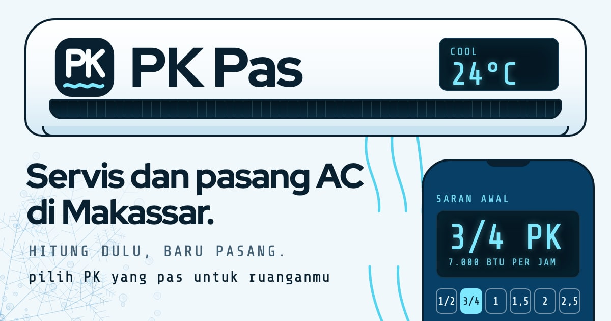

# PK Pas: Servis dan pasang AC di Makassar

Situs company profile demo untuk paket **Standar UMKM** PintuWeb: website 3 sampai 5 halaman untuk usaha (Home, Profil, Layanan, Blog, Kontak) dengan formulir kontak, tombol WhatsApp, teks dasar, dan SEO dasar. PK Pas adalah usaha servis dan pasang AC fiktif dari Makassar untuk rumah, toko, dan kantor kecil. Ciri khasnya: PK dihitung dulu sebelum unit dipasang.

**Demo live:** https://profil-ac.pintuweb.id



> PK Pas adalah usaha fiktif. Nama, alamat (ditandai "alamat contoh"), jam kerja, kecamatan, slot kunjungan, lama kerja, dan tulisannya semua rekaan. Tidak ada nomor telepon, email, atau tarif di situs ini. Tombol WhatsApp memakai `wa.me` tanpa nomor tujuan, dan tidak ada data yang dikirim ke server: formulir kontak dan hasil hitungan Pilih PK hanya disusun menjadi teks pesan di peramban.

## Lima halaman isi paket

- **Beranda** (`/`): tata letak bento. Unit AC dinding sebagai judul halaman, remote mini yang menghitung saran PK awal dari panjang, lebar, dan matahari, foto unit dalam, daftar lima pekerjaan beserta lama kerja contoh, dua tulisan terbaru, wilayah dan jam kerja, dan alur kerja sebagai jalur pipa tembaga.
- **Profil** (`/profil`): cerita singkat, tiga kebiasaan kerja (hitung dulu, jelaskan dulu, rapikan dulu) pada tiga remote kecil, perlengkapan teknisi, wilayah, dan ilustrasi teknisi tanpa wajah.
- **Layanan** (`/layanan`): cuci AC, tambah freon, bongkar-pasang dan pindah unit, perbaikan, dan kontrak perawatan toko dan kantor. Tiap layanan memuat kapan perlu, lama kerja contoh, dan daftar yang dikerjakan.
- **Kabar** (`/kabar`, `/kabar/<slug>`): tiga tulisan contoh (tanda AC perlu dicuci, cara memilih PK untuk kamar, pindah rumah dengan AC) lengkap dengan data terstruktur BlogPosting.
- **Kontak** (`/kontak`): formulir yang menyusun pesan WhatsApp (nama, kebutuhan, jumlah unit, kecamatan, waktu, catatan), jam kerja, alamat contoh, dan peta ilustrasi kecamatan.

## Satu halaman khas: Pilih PK

`/pilih-pk` menghitung saran PK dari panjang dan lebar ruangan, kena matahari langsung atau tidak, lantai atas atau bawah, dan jumlah orang. Aturannya kasar: luas dikali 500 BTU per jam, tambah 10 persen bila kena matahari, tambah 10 persen bila tepat di bawah atap, dan tambah 600 BTU untuk tiap orang setelah yang kedua. Hasilnya dicocokkan ke kelas yang dijual (1/2, 3/4, 1, 1,5, 2, dan 2,5 PK), lengkap dengan rincian hitungan, catatan bila hasilnya dekat batas kelas, denah ruangan berskala, paket layanan yang cocok (tanpa harga), dan lima slot kunjungan teknisi contoh. Ringkasannya bisa dikirim lewat WhatsApp. Label "Contoh perhitungan, bukan penawaran harga" selalu tampil di atas hasil. Remote di beranda mengisi nilai awalnya lewat `?p=4&l=3&m=1`.

## Identitas visual

- **Huruf:** Red Hat Display (judul), Red Hat Text (teks), dan Share Tech Mono (angka di layar remote dan label). Semua lewat `next/font`, variabel dipasang di `<html>`.
- **Warna:** biru es yang dominan (salju, es, biru jernih), tinta malam untuk layar dan kartu gelap, cyan untuk angka LCD, dan sedikit tembaga serta oranye (pipa, matahari). Kontras diperiksa dengan axe: 0 pelanggaran.
- **Motif:** embun beku (tetes dan ranting kristal, digambar sendiri), garis aliran angin (SVG yang bergerak pelan, berhenti bila gerak dikurangi), kartu berbentuk remote AC (sudut atas bulat, jendela inframerah di tepi atas), layar LCD, unit AC dinding yang digambar dengan CSS sebagai judul halaman, dan jalur pipa tembaga untuk alur kerja.
- **Tata letak:** bento berbasis grid 12 kolom, dimulai dari HP (390 px) lalu desktop (1280 px). Tidak ada bayangan di mana-mana dan tidak ada sudut membulat seragam.

## Model data

- `lib/data.js`: `site`, `navigasi`, `kecamatan`, `layanan` (kapan perlu, lama kerja contoh, yang dikerjakan, foto), `kelasPK`, `slotKunjungan`, `caraKerja`, `prinsip`, `perlengkapan`.
- `lib/kabar.js`: tiga tulisan sebagai daftar blok (judul, paragraf, daftar, tabel).
- `lib/hitung.js`: `hitungPK()`, `paketCocok()`, dan format angka (titik ribuan, koma desimal).
- `lib/seo.js`: metadata Open Graph per halaman dan JSON-LD (HVACBusiness tanpa telepon dan tanpa rating, BreadcrumbList, BlogPosting). `lib/wa.js`: tautan WhatsApp tanpa nomor. `lib/format.js`: tanggal panjang.

## Teknologi

- Next.js 15.5 (App Router) dan React 19, JavaScript dengan `jsconfig`
- Tailwind CSS v4 (`@theme static` di `app/globals.css`)
- Gambar statis tanpa Image Optimization: varian WebP di `public/_img/` lewat `image-loader.js`. Setelah mengganti foto di `public/images`: `node scripts/static-images.mjs . --dirs public/images`

## Menjalankan secara lokal

```bash
npm install
npm run dev
```

Build produksi: `npm run build` lalu `npm start`. Pemeriksaan kode: `npm run lint`.

## Kredit foto dan ilustrasi

Foto berlisensi CC0 1.0 atau domain publik; ilustrasi dan motif digambar sendiri. Daftar lengkap ada di [`public/images/SUMBER.md`](public/images/SUMBER.md).

---

Dibuat oleh [PintuWeb](https://www.pintuweb.id), jasa pembuatan website.
